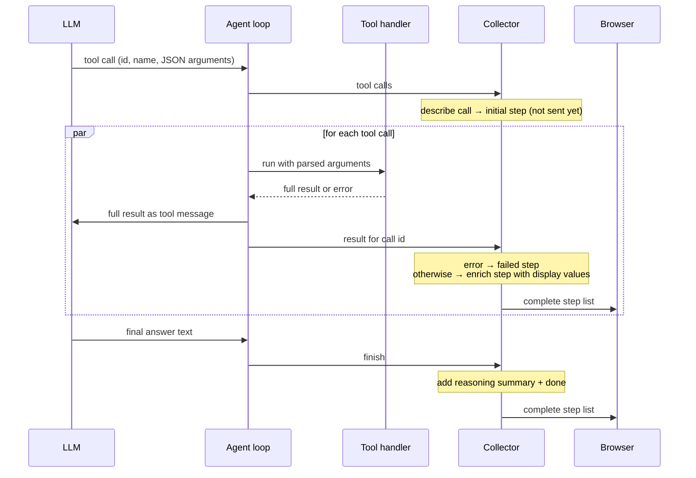
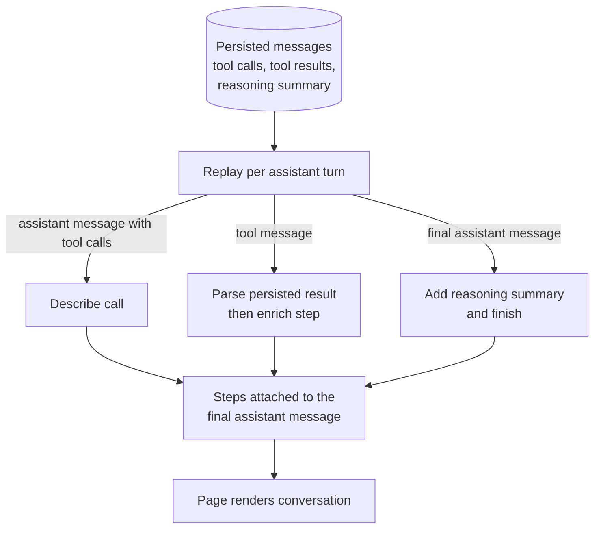

# AI Activity

AI Activity shows users what the assistant did to produce an answer: which tools it used, with what
input, what came out, and a reasoning summary if the model provides one. For adding a tool see
[tool-calls.md](tool-calls.md).

## Principles

- **Derived, not stored.** Activity is never persisted on its own. It is rebuilt from the persisted
  tool calls, tool results and reasoning summary, so live streaming and reload share one code path.
- **Display only.** The client receives only the values it needs to display. The full tool result
  goes to the model and the database, not to the browser. Steps are never fed back to the model.
- **Opt-in per tool.** A tool appears only if it declares how to describe itself. Other tools run
  normally and stay invisible.
- **Old data stays readable.** Persisted arguments and results are never migrated. Old shapes are
  transformed when parsed, and none is ever dropped.
- **Never break the answer.** Malformed arguments or results degrade a step; they never abort the
  response or the page load.

## Concepts

| Concept             | Meaning                                                                          |
| ------------------- | -------------------------------------------------------------------------------- |
| Step                | One display item: a tool call, the reasoning summary, or the final "done" marker |
| Activity descriptor | Per-tool definition of how to turn a call and its result into a step             |
| Collector           | Builds the ordered step list from calls, results and reasoning deltas            |
| Stream event        | A step list sent inline in the response text stream                              |
| Reconstruction      | Rebuilding steps from persisted messages                                         |

An activity descriptor has three jobs:

1. **Describe the call:** build the initial step from the call's arguments, as the model sent them
   (e.g. the search query).
2. **Enrich with the result:** copy the values worth showing from the tool result into the step
   (e.g. links, a calculated value, a name the tool assigned).
3. **Read persisted results:** transform old result shapes into the current one, see
   [Persisted data must stay parseable](#persisted-data-must-stay-parseable).

## Live generation

- Results are matched to their step by tool call id. Calls of one round run in parallel, so results
  arrive in any order.
- The model can call tools, read the results and call more tools. All rounds of one answer end up in
  a single step list.
- Steps reach the browser when a tool result arrives and at the end, not when a call starts.
- Each update contains the complete step list, so a missed update cannot leave a gap and steps must
  stay small.
- Reasoning summary text is collected during generation and appears as one step at the end.
- With no tool steps and no reasoning summary, nothing is shown.

## Reload

- The same collector and descriptors are used as in live generation, so both views match.
- Only the message that ends a turn gets the steps.
- The same replay runs whenever stored messages are loaded, including when the history for the next
  model request is built. A failure here would block the conversation, so it must never throw.
- All chat types restore activity on reload, including shared chats. The sensitive-detail hiding
  applied while generating must also apply when reconstructing, so a reload shows the same steps as
  the live view.

## Where does a value come from?

The tool is the only place that decides what happened.

| Value                                                                                                                                       | Source    | Why                                           |
| ------------------------------------------------------------------------------------------------------------------------------------------- | --------- | --------------------------------------------- |
| What the model asked for, unchanged (query, expression, URL list)                                                                           | Arguments | Known before the tool runs                    |
| Anything the tool computes, derives, validates, normalizes or looks up (calculated value, found links, a name it sanitizes or makes unique) | Result    | The handler is the single source of truth     |
| Success or failure                                                                                                                          | Result    | Arguments cannot tell whether the tool worked |

Rules:

- **A step must be correct after its result arrives.** It can be visible earlier, because any tool
  result publishes the whole list. So the described step must make sense from arguments alone, and
  the enriched step carries the final values.
- **Failed tools show no success data.** Values taken from arguments appear even if the tool failed.
  Take anything that implies success from the result, where an error skips enrichment.
- **If the result lacks a needed value, add it to the result.** Extend the handler's result with a
  small field. The model receives results too, so keep the field short.
- **Reload sees the same two inputs.** The persisted call gives the arguments, the persisted tool
  message gives the result. A value in a step must be derivable from these two alone.

Example with a generic search tool:

| Stage                 | Data                                                     | Step                                          |
| --------------------- | -------------------------------------------------------- | --------------------------------------------- |
| Call received         | Arguments `{"query": "weather berlin"}`                  | Detail "weather berlin"                       |
| Result arrives        | Result `{"results": [{"title", "url", "content"}, ...]}` | Links (title, url); content stays server-side |
| Conversation reloaded | The same persisted call and result                       | The same step                                 |

## Persisted data must stay parseable

Tool arguments and tool results are stored in the database exactly as they were at the time of the
call. There are no data migrations, so every conversation ever created is replayed through the
current descriptors on each reload. Descriptors are deterministic functions of this data: changing
what a descriptor reads or emits changes how existing conversations render.

- **Prefer additive changes.** New fields must be optional for the descriptor, because old data does
  not have them.
- **Shapes may change if old shapes are transformed on parse.** Renaming or removing a field,
  changing a type or changing the meaning of a value is only safe when the persisted-result parsing
  recognizes the old shape and normalizes it into the current one.
- **Never drop support for an old shape.** Every shape a tool ever stored must stay parseable, and
  the result enrichment only ever sees the current shape.
- **Arguments have no separate parsing step.** Describing the call must itself accept old argument
  shapes, or fall back to a step without detail.

## Rendering

- **While generating:** the latest step's title replaces the loading label. Each label stays visible
  for a minimum time so fast steps stay readable.
- **After generating:** a collapsible panel under the assistant message lists the steps.
- **Per step:** icon and title per tool, short detail text (truncated), optional result, a capped
  list of links (http/https only), and a failed state.

## Privacy and trust

- Only the values a descriptor emits leave the server. File contents, page text and search snippets
  stay server-side.
- Shared chats hide details that would reveal the owner's data (for example uploaded file names)
  from steps, both while generating and after reload.
- When adding a tool, decide whether its arguments or result values reveal such data. If they do,
  the hiding for shared chats must cover them.

## Failure behavior

| Situation                                                    | Result                                                                     |
| ------------------------------------------------------------ | -------------------------------------------------------------------------- |
| Arguments invalid                                            | Step without detail                                                        |
| Tool returns or throws an error                              | Step marked failed; result enrichment skipped                              |
| Result enrichment throws                                     | Logged; step stays as described                                            |
| Persisted result is not valid JSON or matches no known shape | Step stays as described                                                    |
| Persisted result parser throws                               | Step marked failed                                                         |
| Stream chunk is not an activity event                        | Handled as normal answer text                                              |
| Tool has no descriptor                                       | No step; tool still runs                                                   |
| Generation fails                                             | No answer is completed; no activity after reload                           |
| Generation is cancelled with partial output                  | Partial answer and tool messages are stored; activity is rebuilt on reload |
