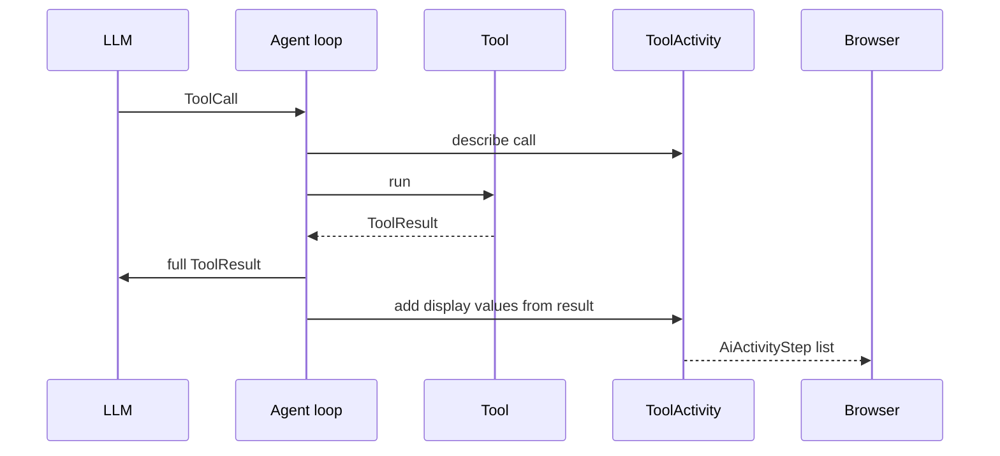
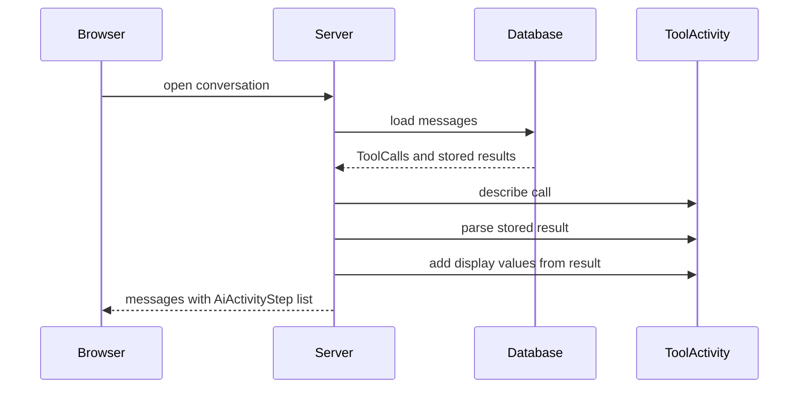

# AI Activity

AI Activity shows users what the assistant did for an answer: which tools it called, with what input,
and what came out. For adding a tool see [tool-calls.md](tool-calls.md).

## Idea

- Steps are never stored. They are rebuilt from the persisted tool calls and tool results, both while
  generating and on reload.
- Each tool describes its own step with a `ToolActivity`: how to turn a `ToolCall` into an
  `AiActivityStep`, how to add values from the `ToolResult`, and how to read stored results.
- An `AiActivityStep` holds only what the UI shows, never the full `ToolResult`.
- Tools without a `ToolActivity` still run, but do not appear.

## While generating

## On reload

All chat types restore activity on reload, including shared chats.

## Persisted data must stay parseable

Tool arguments and results are stored as they were at call time and never migrated, so every old
conversation is replayed through the current code on each reload.

- Prefer additive changes. New fields must be optional.
- A shape may change if the `ToolActivity` transforms the old shape into the current one when
  parsing.
- Only drop an old shape when it is guaranteed that no data of that shape exists anymore.
- Describing the call has no parse step, so it must accept old argument shapes or fall back to a
  step without detail.
- Unparseable data degrades the step and never breaks the page or the answer.

## Error handling

If a tool returns a `ToolErrorResult` (a result with an `error` property), the call is shown as
failed and no result values are added to its step.

## Privacy

- Steps carry only display values. This limits the activity payload only: tool messages are still
  part of the loaded conversation.
- Shared chats hide details that would reveal the owner's data (for example uploaded file names),
  both while generating and on reload. When adding a tool, decide whether its values need hiding.
