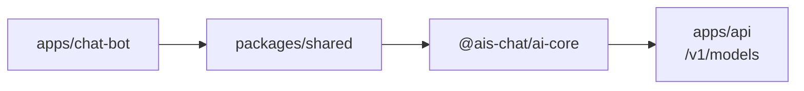

# Mermaid Diagrams

Diagrams in `docs/` are written as [Mermaid](https://mermaid.js.org/) code blocks directly inside
Markdown files. There are no image files and no build step: the diagram source lives next to the
text it explains and is reviewed like any other change.

## Writing a diagram

Use a fenced code block with the `mermaid` language tag:

````markdown

````

Rendered:


## Viewing diagrams

- **GitHub**: Mermaid blocks render automatically in `.md` files, PRs and issues. No setup needed.
- **VS Code**: install the recommended extension from `.vscode/extensions.json`, then open the
  built-in Markdown preview with `Ctrl+Shift+V`, or `Ctrl+K V` for a side-by-side preview. Themes
  are set in `.vscode/settings.json` to match GitHub's light and dark appearance.

## Guidelines

- **Stick to widely supported diagram types**: `flowchart`, `sequenceDiagram`, `classDiagram`,
  `stateDiagram-v2`, `erDiagram` and `gantt`. GitHub may run an older Mermaid version than the VS
  Code extension, so newer or experimental types can render in VS Code but fail on GitHub. When in
  doubt, check the diagram on GitHub (e.g. in a draft PR).
- **Line breaks in labels**: use `<br/>`, not `\n`.
- **Quote labels** that contain special characters such as `()`, `[]`, `:`, `/`, `@` or `·`:
  `node["apps/api (Fastify)"]`.
- **Keep diagrams small and focused**: prefer several small diagrams over one large one. Large
  diagrams become unreadable on GitHub, which scales them down to the page width.
- **Don't hardcode colors**: avoid `style`/`classDef` fill colors so diagrams stay readable in both
  light and dark themes.
- **Describe the diagram in text too**: add a sentence explaining what it shows, so the doc still
  makes sense in plain-text views and for screen readers.
